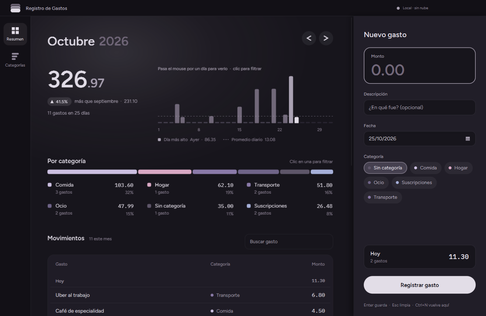
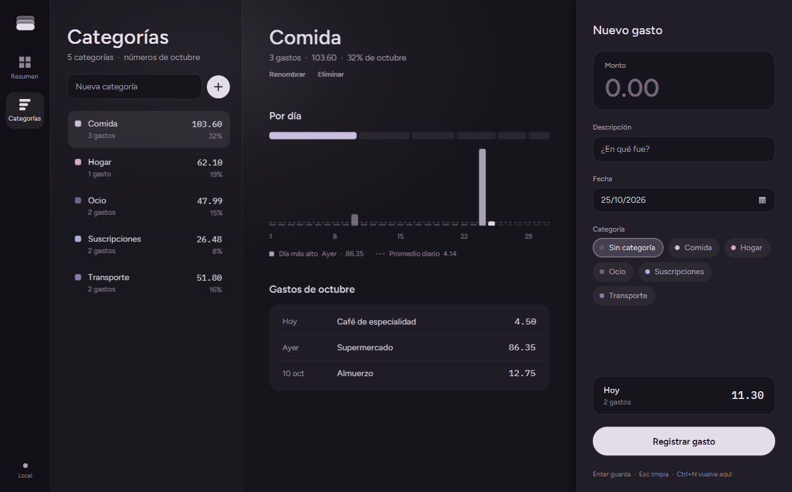

# 03 · Rediseño: paleta gris violácea, Apple · Binance · Steam

El diseño de la fase 2 funcionaba, pero se veía genérico: el típico "dashboard oscuro con
tarjetas". Esta fase lo reemplaza con tu paleta y con composiciones tomadas de
referencias reales (Mobbin: Binance assets overview, Apple Wallet, Copilot Money, YNAB).
Después de construirlo, un revisor independiente lo auditó contra tu pedido y se
corrigieron sus hallazgos. Lo que se cambió por esa revisión se indica abajo.

## Las decisiones de diseño, y por qué

**Paleta: seis tonos, cada uno con un rol, y nada fuera de esa familia.**

| Tono | Rol |
|---|---|
| `#17151C` | fondo base, campos |
| `#292531` | superficies elevadas, tooltip, calendario, "bajó" |
| `#45404F` | días sin gasto, chip elegido, confirmación de borrado |
| `#716879` | barras de la gráfica, año del título |
| `#AAA2B3` | texto secundario, día más alto, anillo de foco |
| `#E2DDE7` | texto principal **y la acción principal** (píldora clara) |

Tu paleta no trae acento. En lugar de inventarle uno, la acción principal es la **única
píldora clara** sobre fondo oscuro, como los botones de Apple en modo oscuro: el contraste
hace el trabajo del color. La primera versión usaba rosa y menta para "subió/bajó" y
pasteles de colores para las categorías. El revisor marcó que eso rompía tu pedido de "nada
fuera de la paleta", así que ahora:
- subió o bajó se lee por el **triángulo** (▲/▼ dibujados), no por el color;
- las categorías usan **tintes de la misma familia** (lavanda, malva, ciruela, violeta) y se
  distinguen por luminosidad;
- eliminar no usa rojo: el aviso es el **segundo clic de confirmación**.

**Tres zonas en vez de pantalla + modal.** Riel de íconos (Steam), contenido al centro y
panel de captura **fijo** a la derecha (como el panel de órdenes de Binance), elevado con
sombra para que se lea como otra capa. Como usas la app tanto para anotar como para
revisar, registrar no puede estar escondido detrás de un botón. Editar carga el gasto en el
mismo panel; ya no hay modal que interrumpa. Abajo del panel está lo que llevas gastado hoy.

**Hero sin caja.** El saldo está sobre el fondo, no dentro de una tarjeta, partido en entero
grande y decimales chicos (Binance y Apple lo hacen así), con una luz difusa detrás, el
mismo gesto de tu imagen de paleta. Al lado van las barras por día (Apple Wallet) con línea
de promedio, y el **día de mayor gasto marcado** en la barra y en la leyenda: "¿en qué día se
me fue?" se responde sin pasar el mouse.

**Sin plantillas.** Se quitaron una franja de tres datos (repetía cifras que ya estaban en
pantalla) y la etiqueta encima del saldo (el título ya dice el mes). El contexto va debajo
del número: "11 gastos en 25 días".

**Movimientos agrupados por día** (listas de Apple) con subtotal del día, en columnas
alineadas (Binance).

**Categorías con la topología de la biblioteca de Steam:** lista a la izquierda y detalle a
la derecha. El detalle muestra los números del mes, la barra del mes con solo esa categoría
encendida, su gráfica por día (el mismo `GraficaDias` del resumen, alimentado con un
`ResumenMes` de solo esa categoría) y sus gastos. Renombrar y eliminar viven en el detalle,
no repetidos en cada elemento.

**Escritorio, no web.** Sin enlaces subrayados ("Hoy" es una píldora junto a las flechas)
y sin cursor de mano: en Windows los controles de escritorio usan la flecha.

**Captura sin fricción (corrección tras probarla).** En la primera prueba real no se pudo
guardar un gasto: el recuadro del monto no parecía un campo y el error salía lejos. Ahora:
- todo el recuadro del monto enfoca el campo y se marca con `:focus-within` (JavaFX 19+);
- el error del monto aparece **debajo del monto**, lo marca y le devuelve el foco;
- el monto se lee como lo escribe una persona: `50`, `12,50`, `Q 1,250.00`, `$1.250,75`
  (reglas en `Formato.leerMonto`, probadas en `FormatoTest` con `@ParameterizedTest`);
- la descripción es opcional: sin ella, el gasto toma el nombre de su categoría.

## Lo técnico que vale la pena entender

**Migraciones de datos (V3 y V4).** Las categorías guardan su color en la base (V2). Cada
cambio de paleta traduce los colores guardados con un `UPDATE ... CASE`. Son migraciones de
**datos**, no de esquema, y se versionan igual: una base vieja y una nueva terminan con los
mismos colores. V4 corrige a V3 en vez de reescribirla. La propia V4 sí se editó una vez,
cuando la revisión encontró dos colores indistinguibles: todavía no había salido de las
bases temporales de prueba. Desde que se publique, la regla es estricta: **una migración
aplicada no se toca**, se agrega la siguiente.

**Íconos SVG con `-fx-shape`** (`Iconos.java`). Una `Region` con `-fx-shape: "M4 4h7v7H4z..."`
se dibuja con esa forma, rellena con `-fx-background-color` y escalada al tamaño de la
Region. El color cambia por CSS (`.nav-item:selected .icono-nav`) sin imágenes. Es un
`enum`: cada constante guarda su trazo y sabe crear su nodo o un botón con él.

**Gráfica sin la librería de charts** (`GraficaDias.java`). Las `XYChart` de JavaFX cuestan
mucho de estilizar. Aquí es un `GridPane` con una columna por día y `percentWidth` igual
para todas, así barras y etiquetas del eje se alinean solas. La línea de promedio es una
Region **no administrada** (`setManaged(false)`): el `StackPane` no la acomoda y se
posiciona a mano con `setLayoutY`.

**Barra segmentada.** Cada tramo tiene
`prefWidthProperty().bind(barra.widthProperty().multiply(proporción))`: si cambia el ancho
de la ventana, los tramos se recalculan solos.

**Orden de las capas de fondo (bug real de esta fase).** En JavaFX,
`-fx-background-color: A, B` pinta **A abajo y B encima**, al revés que `background` en CSS
web. La luz del hero no se veía porque estaba primero y el fondo sólido después, tapándola.
Se descubrió midiendo píxeles de la captura (todos `#17151C` exactos) y probando el
degradado aislado. El mismo orden es el que hace funcionar el truco del borde fino
(`borde, relleno` con `insets 0, 1`).

**Sombras y capturas.** La sombra del panel sale de los bordes del nodo raíz. Por eso
`CapturaPantallas` captura la **escena** (tamaño exacto de la ventana) y no el nodo, que
mediría más.

**JavaFX CSS no es CSS web.** No hay `:first-child`, ni `letter-spacing`, ni
`font-feature-settings`. Por eso las cifras alineadas en columnas van en IBM Plex Mono: es
la única forma de tener números de ancho fijo.

**Nombres de fuentes.** Los archivos de Figtree vienen de su versión variable y JavaFX los
registra como "Figtree Light", "Figtree Light Medium" y "Figtree Light SemiBold" (el trazo
sí es 400/500/600). El CSS los usa tal cual.

**Contrato de dirección.** El inicio de `estilos.css` describe la intención del diseño en
cinco bloques. Sirve para revisar cambios futuros: si algo lo contradice, es una decisión
nueva, no un ajuste.

## Archivos

- Nuevos: `ui/Iconos.java`, `ui/GraficaDias.java`, `ui/PanelGasto.java`,
  `db/migraciones/V3__paleta_violeta.sql`, `V4__categorias_en_tono.sql`,
  `ui/fuentes/Figtree-*.ttf`, `PRODUCT.md` (raíz).
- Reescritos: `VentanaPrincipal`, `VistaResumen`, `VistaCategorias`, `estilos.css`.
- Eliminados: `FormularioGasto.java` (el modal), fuentes Inter.
- Modelo: `ResumenMes.porDia()`, `TotalCategoria.movimientos`,
  `ModeloUi.seleccionadoProperty()` y `ModeloUi.gastosDeHoy()`.

## Pendiente

- **Íconos por categoría** elegidos por el usuario (el revisor lo propuso como "carátula" de
  la biblioteca). Requiere guardar el ícono en la base: es una función nueva, no un ajuste.
- **Moneda:** usas quetzales y dólares; falta decidir el modelo (ver la conversación).
